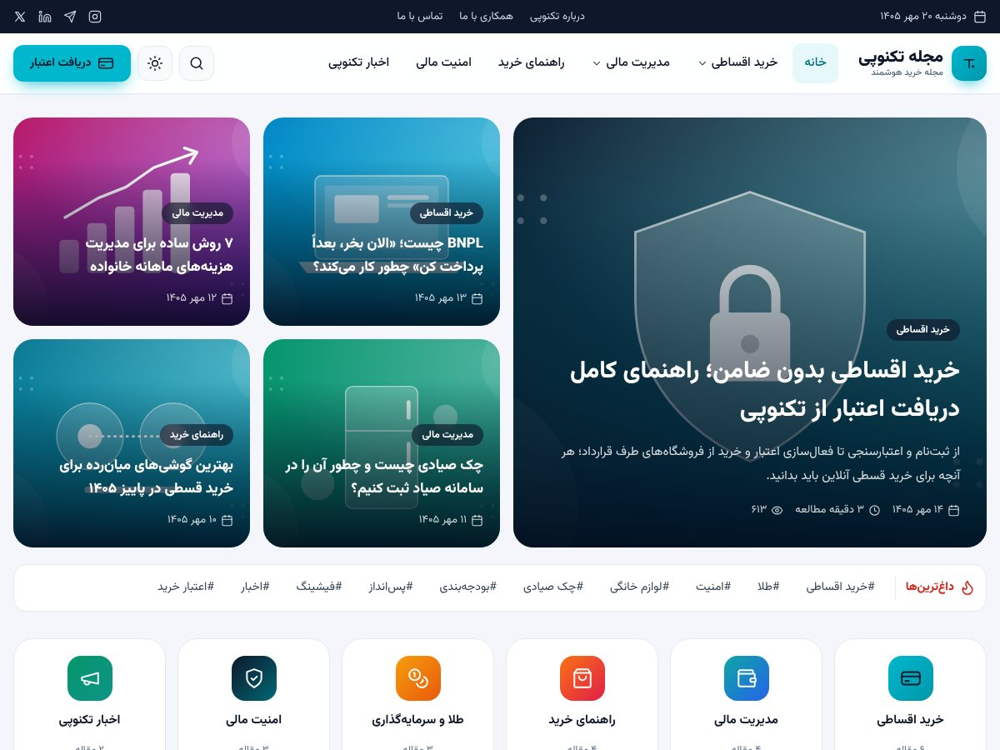

<div dir="rtl">

# قالب وردپرس «تکنوپی بلاگ» (TechnoPay Blog)

قالب مجله/بلاگ فارسی و راست‌چین برای وبلاگ تکنوپی؛ با صفحه اصلی مجله‌ای، حالت تاریک، فهرست مطالب خودکار، محاسبه‌گر اقساط، تاریخ شمسی و فونت وزیرمتن (بدون وابستگی به CDN).



## امکانات

- **صفحه اصلی مجله‌ای** با بخش‌های قابل روشن/خاموش‌کردن:
  مطالب ویژه (نوشته‌های سنجاق‌شده در اولویت‌اند)، نوار «داغ‌ترین‌ها» (برچسب‌ها)، کاشی دسته‌بندی‌ها، آخرین مطالب با تب دسته‌ها + سایدبار، بنر دریافت اعتبار، بلوک دسته ویژه، مراحل دریافت اعتبار، دو ستون دسته‌ها و خبرنامه.
- **صفحه نوشته**: نوار پیشرفت مطالعه، فهرست مطالب خودکار (از تیترهای H2/H3)، زمان مطالعه، شمارنده بازدید، اشتراک‌گذاری (تلگرام، واتس‌اپ، ایکس، لینکدین، کپی لینک)، باکس نویسنده، مطلب قبلی/بعدی، دیدگاه‌های تودرتو و مطالب مرتبط.
- **آرشیو دسته/برچسب/نویسنده و جستجو** با مرتب‌سازی (جدیدترین، پربازدیدترین، پربحث‌ترین) و نمایش لیستی/شبکه‌ای.
- **ابزارک‌های اختصاصی**: پربازدیدترین‌ها، محاسبه‌گر اقساط، بنر دریافت اعتبار.
- **الگوهای بلوک (Patterns)** برای ویرایشگر: باکس نکته، باکس هشدار، باکس دعوت به دریافت اعتبار و سوالات متداول آکاردئونی.
- **حالت تاریک** (خودکار بر اساس سیستم‌عامل + دکمه تغییر دستی).
- **تاریخ شمسی** داخلی (اگر افزونه پارسی‌دیت فعال باشد، از آن استفاده می‌شود).
- **فونت وزیرمتن با ارقام فارسی** به‌صورت محلی؛ هیچ درخواستی به Google Fonts یا Gravatar ارسال نمی‌شود (آواتار حرفی).
- **کاملاً واکنش‌گرا** با منوی کشویی موبایل و جستجوی تمام‌صفحه (کلید میان‌بر `/`).
- **آیکون و رنگ اختصاصی برای هر دسته** (در صفحه ویرایش دسته).
- **ویرایشگر بصری شبیه المنتور** (منوی «مجله تکنوپی»): جابه‌جایی، افزودن و حذف عنصرها با کشیدن و رها کردن روی خود صفحه، تنظیم اندازهٔ فونت و رنگ برند (بخش بعدی).
- سازگار با Yoast SEO و Rank Math (بردکرامب و دسته اصلی).
- **کنونیکال آرشیوها:** صفحه‌های ۲ به بعد (دسته، برچسب، نویسنده، تاریخ، صفحهٔ نوشته‌ها) و نسخه‌های `?sort=` و `?view=` به صفحهٔ اول همان آرشیو کنونیکال می‌شوند. اگر Yoast SEO، Rank Math، All in One SEO، SEOPress یا The SEO Framework فعال باشد، خروجی همان افزونه اصلاح می‌شود، وگرنه قالب خودش تگ را چاپ می‌کند (فیلترهای `technopay_print_canonical` و `technopay_archive_first_page_url` برای تغییر).

## نصب

1. کل محتوای این مخزن را در یک پوشه با نام `technopay-blog` فشرده (zip) کنید.
2. در پیشخوان وردپرس: **نمایش ← پوسته‌ها ← افزودن ← بارگذاری پوسته** و فایل zip را آپلود و فعال کنید.

یا مستقیماً مخزن را در مسیر `wp-content/themes/technopay-blog` کلون کنید.

**نیازمندی‌ها:** وردپرس ۶٫۳ یا بالاتر، PHP ۷٫۴ یا بالاتر.

## ویرایشگر بصری (منوی «مجله تکنوپی»)

در پیشخوان منوی مستقل **«مجله تکنوپی»** هست. از آن صفحهٔ دلخواه را در **ویرایشگر بصری** باز کنید (یا روی سایت، با دکمهٔ «ویرایشگر بصری» در نوار مدیریت): خود صفحه با یک پنل کناری باز می‌شود و مثل المنتور روی خود صفحه کار می‌کنید.

- **جابه‌جایی:** هر عنصر وقتی ماوس را رویش می‌برید یک نوار ابزار دارد؛ با دستگیرهٔ «⠿» آن را بکشید و جای دیگر رها کنید، حتی به ناحیهٔ دیگر (مثلاً «قبلی/بعدی» را از زیر مقاله به زیر «مطالب مرتبط» ببرید). دکمه‌های ↑ ↓ همین کار را با کلیک انجام می‌دهند.
- **تنظیمات هر عنصر:** روی عنصر کلیک کنید (یا ⚙) تا عنوان، تعداد، دسته و ... در پنل باز شود. ✕ حذفش می‌کند.
- **افزودن:** تب «عناصر» (بکشید روی صفحه یا «+») یا دکمهٔ «+ افزودن عنصر به این ناحیه» زیر هر ناحیه. محاسبه‌گر اقساط، بنر، دسته‌ها، برچسب‌ها، آخرین/پربازدیدترین‌ها، نویسنده، دیدگاه‌ها، مطالب مرتبط، خبرنامه و ... را می‌شود در هر صفحه گذاشت.
- **سبک سایت:** اندازهٔ فونت کل سایت، اندازهٔ متن مقاله، عرض محتوا، رنگ برند و رنگ متن دکمه‌ها؛ بلافاصله روی صفحه دیده می‌شود.
- **صفحه‌ها:** بین صفحه اصلی، مقاله، آرشیو، جستجو و ۴۰۴ جابه‌جا شوید؛ جای سایدبار (چپ/راست/بدون) را هم همین‌جا عوض کنید.
- **پیش‌نویس و انتشار:** تغییرات اول در پیش‌نویس شخصی شما ذخیره می‌شود و بازدیدکننده‌ها چیزی نمی‌بینند. با «پیش‌نمایش» نتیجه را ببینید و با «انتشار» روی سایت بیاورید؛ «دور انداختن» همه را برمی‌گرداند.
- **سایدبار چسبان:** ابزارکی که در ناحیهٔ «سایدبار — چسبان» بگذارید با اسکرول زیر هدر می‌ماند (فقط دسکتاپ). برای چسباندن کل سایدبار همه را آنجا بگذارید.
- ویرایشگر برای دسکتاپ (پنجرهٔ حداقل ۱۲۰۰ پیکسل) است. عنصرهایی که فقط یک‌بار معنی دارند (عنوان مقاله، متن، دیدگاه‌ها، نتایج و ...) از تب «عناصر» دوباره اضافه نمی‌شوند.
- منو، هدر و فوتر، لوگو و متن بنر/مراحل/خبرنامه از «سفارشی‌سازی» و «فهرست‌ها» تغییر می‌کند؛ لینک آن‌ها در صفحهٔ «مجله تکنوپی» هست.

**چیدمان لیستی:** زیرمنوی «چیدمان لیستی» همان چیدمان به‌صورت دو ستون «فعال/غیرفعال» است (بدون پیش‌نمایش زنده) و پشتیبان‌گیری/وارد کردن JSON دارد. هر صفحه دکمهٔ «بازگردانی به پیش‌فرض» دارد. هر ذخیره در آنجا پیش‌نویس‌های ویرایشگر بصری را کنار می‌گذارد.

برای توسعه‌دهنده‌ها: بلوک/ناحیه/صفحهٔ جدید با فیلتر `technopay_layout_registry` اضافه می‌شود (هر بلوک یک تابع رندر، یک شمای تنظیمات و نوع `wide`/`column`/`widget` دارد؛ هر ناحیه فهرست بلوک‌های مجاز و نوع `wide`/`column`/`sidebar`/`card`). کتابخانهٔ [SortableJS](https://github.com/SortableJS/Sortable) (مجوز MIT) داخل `assets/vendor/` است.

## راه‌اندازی اولیه

| کار | مسیر در پیشخوان |
| --- | --- |
| زبان سایت را «فارسی» کنید | تنظیمات ← عمومی ← زبان سایت |
| پیوندهای یکتا را روی «نام نوشته» بگذارید | تنظیمات ← پیوندهای یکتا |
| لوگو (فقط خود لوگو نمایش داده می‌شود؛ بدون آیکون و نام سایت)، نسخهٔ حالت تاریک و ارتفاع لوگو | نمایش ← سفارشی‌سازی ← هویت سایت |
| منوها (منوی اصلی، نوار بالا، فوتر) | نمایش ← فهرست‌ها |
| متن‌ها، لینک‌ها، شبکه‌های اجتماعی، اطلاعات تماس، نماد اعتماد و بخش‌های صفحه اصلی | نمایش ← سفارشی‌سازی ← **تنظیمات قالب تکنوپی** |
| ابزارک‌های سایدبار | نمایش ← ابزارک‌ها (اگر خالی باشد، ابزارک‌های پیش‌فرض قالب نمایش داده می‌شوند) |
| آیکون و رنگ دسته‌ها | نوشته‌ها ← دسته‌ها ← ویرایش دسته |
| مطالب ویژه صفحه اصلی | نوشته را «سنجاق» کنید (چسبیده به صفحه اصلی) |

### نکته‌ها

- **لوگو (مثلاً لوگوی تایپوگرافی):** در «هویت سایت» لوگو را انتخاب کنید؛ از آن لحظه در هدر، منوی موبایل و فوتر فقط همان لوگو دیده می‌شود. بهتر است PNG یا WebP با پس‌زمینهٔ شفاف و دو برابر اندازهٔ نمایش (مثلاً ارتفاع ۱۰۰ تا ۲۰۰ پیکسل) بگذارید (وردپرس به‌طور پیش‌فرض SVG را نمی‌پذیرد). اگر لوگو تیره است، «لوگوی حالت تاریک» را هم بگذارید یا گزینهٔ «لوگو در حالت تاریک سفید شود» را بزنید. اسلایدر «ارتفاع لوگو» اندازه را تنظیم می‌کند (در موبایل حداکثر ۳۶ پیکسل).

- **زیرمنو با توضیح:** در «فهرست‌ها»، از «تنظیمات صفحه» گزینه «توضیحات» را فعال کنید؛ توضیح هر آیتم زیرمنو زیر عنوان آن در منوی بازشونده نمایش داده می‌شود.
- **خبرنامه:** تا زمانی که شورت‌کد فرم (مثلاً از افزونه خبرنامه) یا آدرس ارسال فرم (Mailchimp/MailerLite) را در تنظیمات وارد نکنید، این بخش به بازدیدکنندگان نشان داده نمی‌شود.
- **نماد اعتماد (اینماد و ...):** کد HTML نماد را در «فوتر و اطلاعات تماس» قرار دهید.
- **محاسبه‌گر اقساط:** نرخ سود، بازه مبلغ و متن توضیح از بخش «محاسبه‌گر اقساط» قابل تغییر است. خروجی آن تقریبی است.
- **تاریخ شمسی در کل سایت:** قالب تاریخ‌های خودش را شمسی نمایش می‌دهد. برای شمسی‌شدن تاریخ در بلوک‌های پیش‌فرض وردپرس و پیشخوان، افزونه [WP-Parsidate](https://wordpress.org/plugins/wp-parsidate/) را نصب کنید؛ قالب به‌طور خودکار با آن هماهنگ می‌شود.
- **شمارنده بازدید و کش:** شمارنده داخلی قالب بازدید مدیران و نویسندگان را حساب نمی‌کند. اگر از کش تمام‌صفحه استفاده می‌کنید، می‌توانید شمارش را به افزونه‌ای مثل WP-PostViews بسپارید:

```php
// در functions.php یک قالب فرزند یا افزونه کوچک:
add_filter( 'technopay_views_meta_key', function () { return 'views'; } );
add_filter( 'technopay_track_views', '__return_false' );
```

## شخصی‌سازی ظاهر

**رنگ برند:** در «نمایش ← سفارشی‌سازی ← تنظیمات قالب تکنوپی ← رنگ برند» یک رنگ بدهید (پیش‌فرض فیروزه‌ای `#00b7ce`). دکمه‌ها، نشان‌ها، خط‌های رنگی و بنرها از روی همین رنگ ساخته می‌شوند؛ رنگ لینک‌ها، هاور، بلوک‌های تیره و حالت تاریک هم خودکار و با کنتراست خوانا (WCAG AA) محاسبه می‌شوند. متن روی دکمه‌ها به‌صورت پیش‌فرض سفید است (با سایهٔ ظریف)؛ چون سفید روی رنگ‌های روشن مثل فیروزه‌ای کنتراست کمی دارد، گزینهٔ «رنگ متن روی دکمه‌ها» را روی «خودکار» بگذارید تا سفید یا سرمه‌ای (هر کدام خواناتر) انتخاب شود.

**روشن/خاموش‌کردن بخش‌های صفحه اصلی:** در «سفارشی‌سازی ← صفحه اصلی — نمایش بخش‌ها» (قبل از فعال‌سازی قالب هم در پیش‌نمایش کار می‌کند). بعد از اینکه چیدمان صفحه اصلی را در «مجله تکنوپی» (ویرایشگر بصری یا چیدمان لیستی) منتشر/ذخیره کنید، مدیریت بخش‌ها از همان‌جاست.

شکل (گردی گوشه‌ها، سایه‌ها و ...) در ابتدای فایل `assets/css/main.css` به‌صورت متغیر تعریف شده است:

```css
:root {
  --primary: #00b7ce;   /* رنگ برند (با «رنگ برند» در سفارشی‌سازی بازنویسی می‌شود) */
  --accent: #ffb21e;    /* رنگ تأکیدی */
  --radius: 16px;
  ...
}
```

برای تغییرات بیشتر، پیشنهاد می‌شود یک **قالب فرزند (Child Theme)** بسازید تا با به‌روزرسانی قالب، تغییراتتان از بین نرود.

## ساختار فایل‌ها

```
technopay-blog/
├── style.css               # مشخصات قالب
├── functions.php           # راه‌اندازی، فایل‌های CSS/JS، سایدبارها
├── header.php / footer.php
├── front-page.php          # صفحه اصلی مجله
├── single.php              # صفحه نوشته
├── archive.php / search.php / index.php / page.php / 404.php
├── comments.php / searchform.php / sidebar.php
├── inc/
│   ├── layout.php          # رجیستری صفحه/ناحیه/بلوک، پیش‌فرض‌ها، پاک‌سازی و رندر چیدمان
│   ├── layout-blocks.php   # تابع رندر هر بلوک
│   ├── layout-admin.php    # چیدمان لیستی (زیرمنوی «مجله تکنوپی»)
│   ├── editor.php          # ویرایشگر بصری: پیش‌نویس، سبک سایت، AJAX
│   ├── hub.php             # منوی «مجله تکنوپی» و صفحهٔ شروع
│   ├── colors.php          # رنگ برند و رنگ‌های مشتق‌شده با کنتراست خوانا
│   ├── content-toc.php     # فهرست مطالب خودکار
│   ├── seo.php             # کنونیکال آرشیوها (صفحه‌بندی به صفحهٔ اول)
│   ├── helpers.php         # تاریخ شمسی، ارقام فارسی، بازدید، زمان مطالعه، تصاویر
│   ├── template-tags.php   # متا، بردکرامب، صفحه‌بندی، اشتراک‌گذاری، دیدگاه
│   ├── customizer.php      # تنظیمات «سفارشی‌سازی»
│   ├── widgets.php         # سایدبارها و ابزارک‌های اختصاصی
│   ├── menus.php           # کلاس‌های منو و منوی جایگزین
│   └── term-meta.php       # آیکون و رنگ دسته‌ها
├── template-parts/         # کارت‌ها، لوگو، آیکون‌ها و بخش‌های صفحه اصلی (home/)
├── patterns/               # الگوهای بلوک
└── assets/
    ├── css/main.css        # استایل اصلی
    ├── css/editor.css      # استایل ویرایشگر
    ├── css/layout-admin.css / js/layout-admin.js   # رابط چیدمان لیستی
    ├── css/editor-ui.css / js/editor-ui.js         # رابط ویرایشگر بصری
    ├── vendor/sortable.min.js   # SortableJS (MIT)
    ├── js/main.js          # اسکریپت‌ها (بدون jQuery)
    ├── fonts/vazirmatn/    # فونت وزیرمتن (مجوز OFL)
    └── img/covers/         # کاورهای پیش‌فرض برای نوشته‌های بدون تصویر شاخص
```

## مجوز

قالب تحت مجوز GPLv2 یا بالاتر منتشر شده است. فونت [وزیرمتن](https://github.com/rastikerdar/vazirmatn) تحت مجوز SIL Open Font License 1.1 است (`assets/fonts/vazirmatn/OFL.txt`).

</div>
